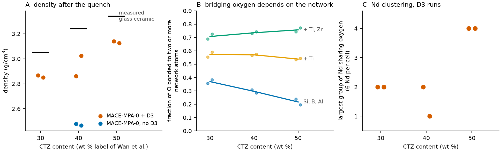
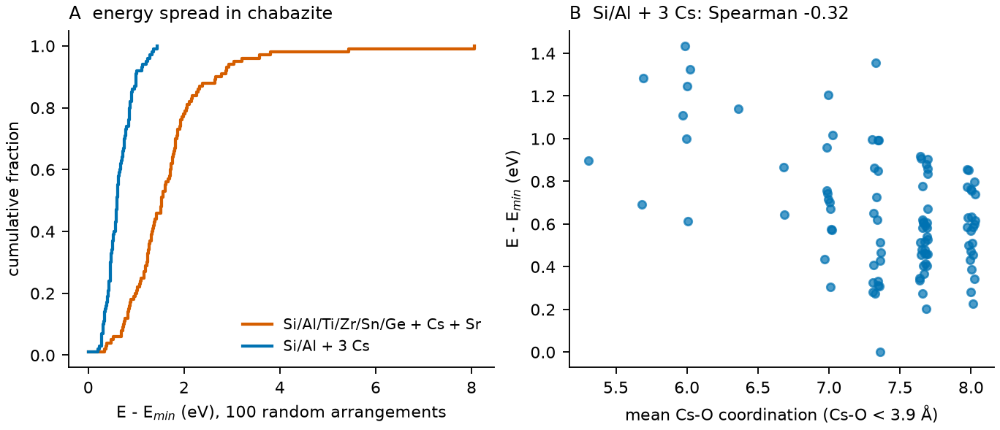
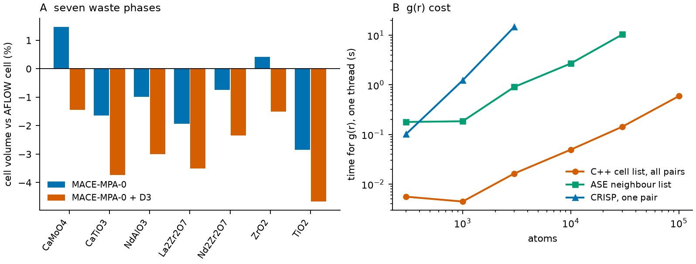

# Multi-cation waste-form glass-ceramics with a foundation potential: a computational pilot

A small, complete run of a workflow for high-entropy glass-ceramics for nuclear waste immobilisation. It has four parts:

1. Melt-quench of three borosilicate waste-form glasses (nine oxides, about 350 atoms) with the foundation potential MACE-MPA-0, with and without D3 dispersion.
2. Symmetry-aware enumeration of multi-cation disorder in a crystalline host (chabazite with six framework cations and two extra-framework cations), ranked with the same potential.
3. Reference structures and symmetry labels for the waste phases from the AFLOW database, compared with the potential.
4. C++ analysis kernels that replace Python hot spots.

Every number below is either recomputed from the CIF files in [structures/](structures/) or re-derived from the stored tables in [results/](results/) by [check_structures.py](check_structures.py) (95 checks, no simulation code needed). The exceptions are the benchmark timings, the 5,280 comparisons with CRISP and the ring-counter speed-ups: they need the original code and machines, so the checker only tests them for consistency with their stored files. Findings that depend on a cutoff, a network definition or a sample size are stated together with that dependence; see also [Limits](#limits).

## Why

Borosilicate glass is the standard waste form for high-level waste, but molybdenum, rare earths, noble metals and sulfate exceed their solubility in the melt and separate as crystalline or salt phases that lower durability [13]. A glass-ceramic places these species in durable crystalline hosts (zirconolite, powellite, pyrochlore) inside a glass matrix. Wan et al. [1] study such zirconolite and powellite borosilicates loaded with simulated waste, where the CaO, TiO2 and ZrO2 content (the label CTZ) decides which crystalline phases form.

High-entropy ceramics carry five or more cations on a shared sublattice [3] and have been proposed as waste hosts [2]. The working hypothesis is that the added configurational entropy raises the solubility of waste species and suppresses segregation, in the crystalline hosts and in the glass. In a glass the entropy term acts on solubility in the melt and does not stabilise a structure, so the hypothesis has to be tested, not assumed.

Testing it computationally needs four building blocks. This pilot checks whether each one runs on realistic compositions and what limits it:

| Question | Part |
|---|---|
| Can a foundation potential melt and quench a nine-oxide waste borosilicate at several hundred atoms and give a sensible structure and density? | glass |
| Can the combinatorics of six framework cations and two large cations be sampled and ranked without DFT for every arrangement? | host |
| Is the reference data for the host and secondary phases available in a public database? | AFLOW |
| Can the structural analysis keep up with the number and size of the structures? | C++ |

## Repository map

| Path | Content |
|---|---|
| [structures/](structures/) | CIF files that carry the claims (index below) |
| [check_structures.py](check_structures.py) | recomputes every claim from the CIFs and tables; prints PASS or FAIL for each |
| [make_figures.py](make_figures.py) | draws the figures in [figures/](figures/) |
| [glass/](glass/) | `composition.py` (compositions of Wan et al., Table 1), `run_glass.py` (packing, melt, quench, hold) |
| [host/](host/) | `run_host.py` (chabazite pilot; needs ZIPPER, see [Limits](#limits)) |
| [aflow/](aflow/) | `aflux_pull.py` (AFLUX queries and downloads), `run_aflow_mace.py` (AFLOW binary, spglib and MACE cross-check) |
| [cxx/](cxx/) | `hegc_core.hpp` (cell list, partial g(r), connectivity) and its stand-alone test |
| [analysis/export_structures.py](analysis/export_structures.py) | writes the CIFs from the raw simulation output |
| [results/](results/) | tables, per-run summaries, relaxed host structures, benchmark files, saved output of the checker |
| [data/](data/) | AFLOW downloads and query log, chabazite framework, IZA frameworks used for the ring check |

### Structure index

All CIFs are P1 with unique atom labels. Glass cells and host structures are the final frame, wrapped into the cell. Motifs are cut out of a glass cell and unwrapped around the first atom, in a box with a 6 Å margin.

| File | Content | Claim it carries |
|---|---|---|
| `structures/glass/glass_ctz{30,40,50}_D3_seed{0,1}.cif` | final cell of each quench with D3 (342 to 366 atoms) | density, coordination, bridging oxygen, Mo and Nd environments |
| `structures/glass/glass_ctz40_noD3_seed{0,1}.cif` | the same composition without D3 | density without dispersion |
| `structures/motifs/nd_cluster_ctz50_seed0.cif` | Nd4O24: four Nd joined through shared oxygen | Nd groups at CTZ-50 |
| `structures/motifs/nd_largest_ctz40_seed0.cif` | Nd2O13: the largest Nd group at CTZ-40 | contrast with CTZ-50 |
| `structures/motifs/mo_cn4_ctz30_d31_seed0.cif`, `mo_cn5_ctz30_d31_seed0.cif` | MoO4 and MoO5 groups (d31: D3 on) | Mo coordination is not purely four |
| `structures/motifs/mo_shared_O_pair_ctz50_d31_seed0.cif` | Mo2O8: two Mo that share oxygen, Mo to Mo 3.33 Å | the one cell where Mo is not isolated at 2.3 Å |
| `structures/host/cha_silica_framework.cif` | chabazite SiO2, 36 T sites, 108 atoms | starting framework |
| `structures/host/he6_{lowest,highest}_E.cif` | Si29 Al3 Ti Zr Sn Ge + Cs + Sr, lowest and highest energy of 100 | charge balance, Loewenstein rule, Cs and Sr sites, energy spread of 8.06 eV |
| `structures/host/csal_{lowest,highest}_E.cif` | Si33 Al3 + 3 Cs, lowest and highest energy of 100 | the single-substituent reference, spread of 1.43 eV |
| `structures/aflow/*.cif` (7 files) | relaxed AFLOW cells of CaMoO4, CaTiO3, NdAlO3, La2Zr2O7, Nd2Zr2O7, ZrO2, TiO2 | space groups and volumes |
| `structures/nets/{LTA,CHA,FER}.cif` | IZA frameworks [11] | independent ring counts |

The host files show the lowest and the highest energy among relaxations that reached 0.1 eV/Å. All 200 relaxed host structures are in `results/host/*/structures_relaxed.extxyz`.

## Method

### Glass

- **Compositions.** Nominal mol % of CTZ-30, 40 and 50 from Table 1 of Wan et al. [1] (SiO2, B2O3, Na2O, Al2O3, CaO, TiO2, ZrO2, Nd2O3, MoO3). The CTZ-20 column sums to 97.4 mol % and is not used. Integer numbers of oxide units were chosen to match the nominal mol % at about 350 atoms (L1 error 1.2 to 1.35 mol %): 366, 362 and 342 atoms, each with 4 Mo, 6 Nd and 2 Al.
- **Starting cell.** Random sequential packing in a cubic cell at the measured glass-ceramic density, then a FIRE relaxation to remove overlaps.
- **Quench.** 1 fs steps. 20 ps NVT at 5000 K (Langevin), a linear ramp to 300 K at 100 K/ps (10^14 K/s, 47 ps) and 10 ps at 300 K, both in NPT with a Berendsen thermostat and barostat and a free cell. 77 ps in total.
- **Potential.** MACE-MPA-0 (medium, float32) [4], with D3(BJ) dispersion [12] in seven of the eight runs. Two seeds per composition; the CTZ-40 composition was also run without D3. No fine-tuning and no DFT reference.
- **Check that the melt forgot the packing.** The cation mean squared displacement at the end of the 5000 K stage is 131 to 177 Ų, 24 to 32 times (V/N)^(2/3).
- **Density.** Mean over the second half of the 300 K hold.
- **Analysis.** Metal to oxygen bonds inside fixed cutoffs (Å): Si 2.0, B 1.9, Al 2.2, Ti 2.5, Zr 2.8, Mo 2.3, Nd 3.1, Na 3.2, Ca 3.1. An oxygen is bridging when it is bonded to two or more network atoms; Q^n of Si counts the bridging oxygens among its four neighbours. Mo or Nd atoms belong to one group when they share an oxygen.

### Host

- **Host.** Chabazite (CHA), hexagonal cell with 36 T sites (R-3m). Two recipes, both charge balanced: six T species (3 Al, Ti, Zr, Sn, Ge on 36 T sites, balanced by Cs+ and Sr2+) and 3 Al balanced by 3 Cs+.
- **Arrangements.** ZIPPER (not public) places the substituents on symmetry-distinct T-site patterns with Loewenstein's rule [9] for Al, places the counter cations, and relaxes positions with MACE-MPA-0 plus D3 at fixed cell (force threshold 0.05 eV/Å, at most 300 steps). 100 arrangements per recipe, drawn at random.
- **Ensemble size.** With p proportional to exp(-E/kT) over the 100 relaxed energies, the effective number of structures is n_eff = exp(-sum p ln p), at 300, 800 and 1300 K. Intervals are bootstrap percentiles over 2000 resamples of the 100 energies.

### AFLOW

`aflux_pull.py` queried the AFLUX API [6] for nine target phases and downloaded the seven it found. The AFLOW 4.1 binary [7] (`--aflowSG`, `--prototype`, `--pearson_symbol`) was compared with spglib and with the space group stored in the database. Each AFLOW relaxed cell was then relaxed again with MACE-MPA-0, with and without D3 (positions and cell, force threshold 0.02 eV/Å, float64).

### Kernels

`hegc_core.hpp` is header-only C++17: a periodic cell list for triclinic cells (neighbour pairs, each image once), partial pair-distance histograms for g(r), and connectivity of centre atoms through shared ligands with union-find. The stand-alone test compares the pair search with a brute-force loop over lattice images (orthorhombic, triclinic, cutoff larger than half the cell), checks that histograms conserve pairs, and checks a chain of bridged tetrahedra. A C++ port of ZIPPER's shortest-path ring enumerator was also written; it is not included (see [Limits](#limits)), but the counts it produced are checked here by an independent enumeration.

### How the claims were checked

[check_structures.py](check_structures.py) uses only ase, numpy, scipy, pandas and spglib. It re-reads the CIFs, recomputes coordination, bridging oxygen, Q^n and Mo and Nd groups with ASE's neighbour list and SciPy's graph routines, and compares them with the tabulated values from the simulation code (largest difference 8e-17). It recomputes the host statistics from the stored energies, enumerates the arrangement space of the host from its space group, counts shortest-path rings by exhaustive cycle enumeration followed by the Franzblau test [10], and recomputes space groups with spglib. A bootstrap uses seed 0; the permutation test uses 20,000 draws with seed 0.

## Results

### 1. Glass



*A: density of the final cells. Black bars: densities reported for the crystallised glass-ceramics. B: fraction of oxygen bonded to two or more network atoms for three definitions of the network (mean of two seeds). C: largest group of Nd atoms that share oxygen, D3 runs.*

| Run | Atoms | Density (g/cm³) | Measured, glass-ceramic (g/cm³) | Difference | Final pressure (GPa) |
|---|---|---|---|---|---|
| CTZ-30, D3, seed 0 | 366 | 2.867 | 3.05 | -6.0 % | -0.28 |
| CTZ-30, D3, seed 1 | 366 | 2.851 | 3.05 | -6.5 % | -0.35 |
| CTZ-40, D3, seed 0 | 362 | 2.861 | 3.24 | -11.7 % | -0.31 |
| CTZ-40, D3, seed 1 | 362 | 3.025 | 3.24 | -6.6 % | -0.27 |
| CTZ-50, D3, seed 0 | 342 | 3.141 | 3.34 | -6.0 % | -0.39 |
| CTZ-50, D3, seed 1 | 342 | 3.126 | 3.34 | -6.4 % | -0.33 |
| CTZ-40, no D3, seed 0 | 362 | 2.479 | 3.24 | -23.5 % | -0.34 |
| CTZ-40, no D3, seed 1 | 362 | 2.467 | 3.24 | -23.9 % | -0.36 |

**Density.**
- D3 raises the CTZ-40 density by 15.4 to 22.6 % over the four D3 and no-D3 pairs. Without D3 the density is 24 % below the measured value, with D3 6 to 12 % below. The direction agrees with the report that D3 cuts the density error of MACE-MP-0 for sodium silicate glasses [5].
- The measured values are for the crystallised glass-ceramics, which are denser than the as-quenched glass, so the difference is a rough guide, not an error.
- The D3 means rise with CTZ content (2.86, 2.94, 3.13 g/cm³), but no step is resolved: with two runs per composition the smallest one-sided p-value an exact permutation test can give is 1/6 = 0.17 (the CTZ-30 to CTZ-40 step gives 0.33).
- All cells end at -0.27 to -0.39 GPa. The 10 ps hold did not fully relax the cell, which is still under slight tension, so the densities are somewhat low.

**Local structure (D3 runs, mean of two seeds).**

| | CTZ-30 | CTZ-40 | CTZ-50 |
|---|---|---|---|
| Si coordination | 4.00 | 4.00 | 4.01 |
| B coordination | 3.14 | 3.25 | 3.06 |
| fraction of B with 3 O | 0.82 | 0.75 | 0.94 |
| Ti coordination | 4.57 | 4.71 | 4.96 |
| Zr coordination | 6.08 | 5.81 | 5.95 |
| Mo coordination (2.3 Å) | 4.75 | 4.62 | 4.38 |
| Nd coordination | 7.00 | 6.83 | 7.33 |
| Na, Ca coordination | 5.98, 6.35 | 5.94, 6.46 | 6.05, 6.42 |

- Si is four-coordinate for 97 to 100 % of the Si atoms in every cell. Mean bond lengths inside the cutoffs lie in these ranges over the eight cells: Si-O 1.64 to 1.65 Å, B-O 1.38 to 1.42 Å, Mo-O 1.83 to 1.94 Å, Ti-O 1.88 to 1.94 Å, Zr-O 2.11 to 2.16 Å, Nd-O 2.42 to 2.52 Å, Na-O 2.56 to 2.61 Å, Ca-O 2.44 to 2.52 Å.
- **Bridging oxygen depends on what counts as the network.** Counted over Si, B and Al it falls with CTZ content (0.37, 0.30, 0.22; the runs separate completely and the result holds for all cutoffs shifted by 0.1 Å). With Ti added it is 0.57, 0.57, 0.54, and with Ti and Zr added 0.71, 0.74, 0.76. The first number does not mean a loss of connectivity: Ti and Zr take over the bridging as they replace Si and B. The Q^n distribution of Si changes in the same way:

  | Network | CTZ | Q0 | Q1 | Q2 | Q3 | Q4 |
  |---|---|---|---|---|---|---|
  | Si, B, Al | 30 | 0.01 | 0.18 | 0.41 | 0.29 | 0.11 |
  | | 40 | 0.02 | 0.19 | 0.41 | 0.28 | 0.09 |
  | | 50 | 0.10 | 0.25 | 0.44 | 0.19 | 0.01 |
  | Si, B, Al, Ti, Zr | 30 | 0.00 | 0.00 | 0.11 | 0.47 | 0.42 |
  | | 40 | 0.00 | 0.01 | 0.09 | 0.39 | 0.51 |
  | | 50 | 0.00 | 0.00 | 0.06 | 0.40 | 0.53 |

- **Molybdenum.** The coordination is not sharply four-fold and depends on the cutoff: at 1.9, 2.0, 2.3 and 2.6 Å the mean Mo coordination is 2.97, 3.69, 4.53 and 4.75. At 2.3 Å, 53 % of the Mo have exactly four oxygen neighbours and 41 % have five (`mo_cn4_*.cif`, `mo_cn5_*.cif`). No oxygen is shared between two Mo in 7 of 8 cells at 2.0 and 2.3 Å and in 6 of 8 at 2.6 Å. The exception at 2.3 Å is the CTZ-50, seed 0 cell, where two Mo share oxygen at a Mo-Mo distance of 3.33 Å (`mo_shared_O_pair_*.cif`), the shortest Mo-Mo distance in any cell.
- **Neodymium.** Groups of three or four Nd that share oxygen occur only at CTZ-50, in both runs, for Nd-O cutoffs of 2.9, 3.1 and 3.3 Å; at CTZ-30 and CTZ-40 the largest group has at most two Nd in every D3 cell (`nd_cluster_ctz50_seed0.cif`, `nd_largest_ctz40_seed0.cif`). The shortest Nd-Nd distance is 3.68 to 3.70 Å at CTZ-50 and 4.11 to 5.59 Å at CTZ-30 and CTZ-40. Each cell holds 6 Nd and 4 Mo and each composition has two cells, so these are observations, not statistics.
- Ring counts of the Si, B and Al network are not informative: the quenched networks hold few rings.
- **Noise floor.** The energy per atom of the two quenches of one composition differs by 11.2, 18.3 and 9.6 meV/atom (CTZ-30, 40, 50). Any comparison of glass enthalpies between compositions at this quench rate and cell size has to beat that scatter.
- **Cost.** 8.4 to 13.8 ps per GPU-hour with D3 for about 350 atoms (77 ps in 5.6 to 9.2 h) and 19 to 41 ps per GPU-hour without. The speed differs by a factor of 1.65 between GPU nodes for the same job.

### 2. Multi-cation disorder in chabazite



*A: cumulative distribution of the energy above the lowest of 100 random arrangements. B: energy against mean Cs-O coordination for the Cs-only recipe.*

| | six T species + Cs + Sr (110 atoms) | Si/Al + 3 Cs (111 atoms) |
|---|---|---|
| Energy range, standard deviation, interquartile range (eV) | 8.06, 1.03, 0.78 | 1.43, 0.28, 0.38 |
| Effective number of structures at 300, 800, 1300 K | 1.0, 1.1, 1.9 | 1.0, 3.2, 18.3 |
| Bootstrap 95 % interval of n_eff at 1300 K | 1.3 to 9.8 | 11.8 to 44.0 |
| Cs coordination (Cs-O below 3.9 Å), Cs-O peak | 7.0 ± 0.9, 3.25 Å | 7.4 ± 0.6, 3.25 Å |
| Sr coordination (Sr-O below 3.2 Å), Sr-O peak | 5.6 ± 1.4, 2.55 Å | not present |
| Generation and relaxation time per structure, one GPU | 7.5 s | 4.4 s |
| Relaxations that stop above 0.1 eV/Å | 3 | 3 |

- All 200 structures are charge balanced and none has an oxygen bonded to two Al.
- The six-species landscape is rougher: the standard deviation is 3.7 times larger (converged runs) and the interquartile range 2.0 times larger, so part of the difference is a high-energy tail. A few arrangements dominate the six-species ensemble at 1300 K, and the bootstrap intervals of n_eff do not overlap.
- In the Cs-only recipe lower energy goes with higher Cs coordination (Spearman rho = -0.32, p about 1e-3 from a two-sided permutation test). In the six-species recipe there is no relation (rho = -0.14, p = 0.18). This is a correlation in this sample, not a mechanism.
- **Size of the arrangement space.** The framework has 36 T sites, 36 symmetry operations (the ideal R-3m framework, spglib tolerance 1e-1; at 1e-3 the slightly distorted CIF has 9 operations and the class counts below rise to 556 and 62) and 4 T neighbours per site. All counts refer to this hexagonal cell. Loewenstein-compliant placements of 3 Al: 4908, in 139 symmetry classes (558 and 21 for 2 Al). With four more distinct substituents the six-species recipe has 4.82e9 labelled T patterns, at least 1.34e8 of them symmetry-distinct, before the positions of Cs and Sr. The 100 Cs-only structures contain 100 different Al patterns out of 139 classes; the six-species sample covers about one in 10^6 of its T patterns. The two n_eff values are therefore not measured on equal footing.

### 3. AFLOW



*A: cell volume of MACE-MPA-0 relaxations against the AFLOW relaxed cell. B: time for g(r) on one thread.*

| Phase | Formula in cell | Space group | AFLOW prototype | ΔV without D3 | ΔV with D3 |
|---|---|---|---|---|---|
| powellite | Ca2Mo2O8 | I4₁/a (88) | ABC4_tI24_88_a_b_f | +1.5 % | -1.4 % |
| CaTiO3 | Ca4Ti4O12 | Pnma (62) | AB3C_oP20_62_c_cd_a | -1.7 % | -3.7 % |
| NdAlO3 | Nd2Al2O6 | R-3c (167) | ABC3_hR10_167_b_a_e | -1.0 % | -3.0 % |
| La2Zr2O7 | La4Zr4O14 | Fd-3m (227) | A2B7C2_cF88_227_c_af_d | -1.9 % | -3.5 % |
| Nd2Zr2O7 | Nd4Zr4O14 | Fd-3m (227) | A2B7C2_cF88_227_c_af_d | -0.7 % | -2.3 % |
| baddeleyite ZrO2 | Zr4O8 | P2₁/c (14) | A2B_mP12_14_2e_e | +0.4 % | -1.5 % |
| rutile TiO2 | Ti2O4 | P4₂/mnm (136) | A2B_tP6_136_f_a | -2.8 % | -4.7 % |

- The AFLOW binary, spglib at tolerance 1e-3 and the database give the same space group for all seven phases.
- Volumes without D3 are within -2.8 % to +1.5 % of the AFLOW cells, with D3 within -4.7 % to -1.4 %. D3 lowers each volume by a further 1.6 to 2.9 %.
- The reference is AFLOW's DFT cell, some with a Hubbard U (ldau_type 0 and 2), not an experimental cell: the CIF that AFLOW serves for an entry is its relaxed cell. The comparison therefore mixes model error and calculation settings, and it does not say whether D3 brings the volume closer to experiment.
- Zirconolite (CaZrTi2O7): the Ca-O-Ti-Zr query returns no entry, so the main actinide host has no reference data in the public catalogue. Pollucite (CsAlSi2O6): none of the five Al-Cs-O-Si entries is the cubic Ia-3d phase (230) that was targeted. The catalogue does hold CsAlSi2O6 as a tetragonal I4₁/acd (142) entry (ICSD 84322), which was not pulled here.
- For the chabazite framework the AFLOW binary finds R-3m (166); spglib finds R3 (146) at tolerance 1e-3 and R-3m at 1e-1, because the framework coordinates are slightly distorted.
- `results/aflow/aflowlib_like.jsonl` stores the MLIP results under AFLOW keyword names, the form a larger dataset would take.

### 4. C++ kernels

- The partial g(r) of `hegc_core.hpp` equals CRISP's [8] in 5,280 comparisons (8 glass runs, 4 frames each, 3 values of r_max up to half the cell, every species pair); the largest difference is 0.0. Beyond half the cell CRISP applies the minimum-image convention and counts one image per pair, while the kernel counts all of them, so the two differ there by design.
- One thread, all partial g(r) at once for C++ and one species pair for CRISP: 300 atoms 5.6 ms against 102 ms (18 times), 1,000 atoms 4.4 ms against 1.23 s (277 times), 3,000 atoms 16 ms against 14.7 s (903 times). The C++ time grows linearly with the number of atoms (log-log slope 1.04 from 1,000 to 100,000 atoms), CRISP's with slope 2.2 (300 to 3,000 atoms). 100,000 atoms take 0.59 s. ASE's neighbour list takes 10.4 s at 30,000 atoms against 0.14 s.
- **Rings.** An independent enumeration (every simple cycle through the root atom by depth-first search, then the Franzblau test, no shortest-path graph) gives 408, 396 and 564 rings through the T atoms of LTA, CHA and FER up to size 12, the same totals that the C++ port and ZIPPER's Python code produced. It also gives the analytic counts for diamond (12 six-rings per atom) and simple cubic (12 four-rings and 24 six-rings). The stored benchmark of the C++ ring counter (16 structures, identical counts in 16 of 16) shows 5.9 to 12.0 times the speed of the Python reference on one thread.

## Limits

- **No DFT reference and no fine-tuning.** The glass runs use the foundation model as released. Nothing here says how far its structures are from DFT or experiment, only how far its density is from the reported glass-ceramic densities.
- **Two seeds per composition, 4 Mo and 6 Nd per cell.** Density, Mo and Nd findings are single observations. The quench is 10^14 K/s at about 350 atoms, far faster than laboratory cooling, so part of the density gap may be a quench-rate effect; its size was not measured.
- **Definitions matter.** The bridging-oxygen trend depends on whether Ti and Zr count as network atoms, and the Mo findings depend on the cutoff. The tables above give the numbers for each definition.
- **The CTZ label.** The nine listed oxides of Table 1 contain 27.4, 35.2 and 43.1 wt % of CaO, TiO2 and ZrO2 for the CTZ-30, 40 and 50 mixtures (27.5, 35.3 and 42.7 wt % in the cells, because of integer oxide units). CTZ-x is the paper's name for the composition, not a computed content.
- **Host pilot.** The sample is random and small, the cell is fixed (the energy spread includes strain), no DFT check was made, and 3 of 100 relaxations per recipe stop above 0.1 eV/Å. Loewenstein's rule is applied to Al only. It shows that the workflow runs and what it measures, not a converged ensemble.
- **Not in this repository.** ZIPPER (arrangement generator) and the C++ ring port that is based on it are not released, so `host/run_host.py` documents the protocol but cannot be run from here, and the Python bindings of the C++ kernels are left out. The host results and the ring counts are included as data and are re-checked independently.
- AFLOW-POCC itself was not run.

## Takeaways

1. **A foundation model gets the local chemistry of the glass about right and the density wrong.** Si is four-coordinate, boron is mostly three-coordinate and the bond lengths are sensible, but the density is 6 to 12 % below the reported glass-ceramic values with D3 and 24 % below without it. D3 is necessary for these glasses and it is not sufficient: the remaining gap is several times a 2 % density target, which fine-tuning on DFT data for these compositions would have to close.
2. **Connectivity descriptors need a stated network.** In these glasses Ti and Zr carry a large share of the bridging oxygen, so a descriptor built on Si, B and Al alone changes direction when Ti and Zr are added. Any constraint-counting or Q^n descriptor used to rank compositions inherits that choice.
3. **The glass observations are leads, not results.** Mo is mixed four- and five-coordinate and nearly always isolated, and Nd groups of three or four appear only at CTZ-50. Seeing whether these survive needs more seeds and larger cells; the energy scatter of 10 to 18 meV/atom between quenches sets the resolution for any enthalpy comparison.
4. **Multi-cation host disorder is tractable but sampling-limited.** A relaxation takes 4 to 8 s per structure on one GPU. The energy range is 8.1 eV for the six-species recipe against 1.4 eV for the Cs-only recipe (interquartile range 2.0 times larger), and a few arrangements dominate its ensemble at 1300 K. The six-species recipe has at least 10^8 symmetry-distinct T patterns, so 100 random samples are too few for a converged ensemble; systematic enumeration or basin hopping, with cell relaxation, is the next step.
5. **Reference data is partly missing.** The public AFLOW catalogue has the simple waste phases (7 of 9 targets) and agrees with spglib on their symmetry, but has no zirconolite and no cubic pollucite (a tetragonal CsAlSi2O6 entry exists), so the main actinide host has to be computed.
6. **Analysis cost is not the bottleneck.** The C++ kernels reproduce CRISP's g(r) exactly, scale linearly and handle 10^5 atoms in 0.6 s, so analysis of many large structures is cheap next to the 6 to 9 GPU-hours of one quench.

## Reproduce

```
pip install -r requirements.txt
python check_structures.py          # about 3 minutes, ends with ALL PASS
python make_figures.py
g++ -std=c++17 -O2 -Wall -Wextra -Icxx/include cxx/tests/test_core.cpp -o test_core && ./test_core
```

The saved output of the checker is in [results/check_structures_output.txt](results/check_structures_output.txt). Tested with ase 3.29, numpy 2.4, scipy 1.17, pandas 3.0, spglib 2.7 and matplotlib 3.11.

To rerun a quench (one GPU, 6 to 9 h with D3; needs `requirements-simulation.txt` and the MACE-MPA-0 medium model file):

```
python glass/run_glass.py --ctz 40 --seed 0 --d3 1 --model mace-mpa-0-medium.model --out results/glass
```

To rewrite the CIFs from the raw output: `python analysis/export_structures.py --force`.

## References and data sources

1. Wan, W. et al. Borosilicate glass-ceramics containing zirconolite and powellite for RE- and Mo-rich nuclear waste immobilization. Materials 14, 5747 (2021). Compositions and densities.
2. Zhou, L. et al. High-entropy A2B2O7-type oxide ceramics: a potential immobilising matrix for high-level radioactive waste. J. Hazard. Mater. 415, 125596 (2021).
3. Oses, C.; Toher, C.; Curtarolo, S. High-entropy ceramics. Nat. Rev. Mater. 5, 295 to 309 (2020).
4. Batatia, I. et al. A foundation model for atomistic materials chemistry. J. Chem. Phys. 163, 184110 (2025). The MACE-MP family; MACE-MPA-0 is one of its released checkpoints.
5. Pedone, A.; Bertani, M.; Benassi, M. Revisiting machine learning potentials for silicate glasses: the missing role of dispersion interactions. J. Chem. Theory Comput. 21, 4769 to 4778 (2025).
6. Rose, F. et al. AFLUX: the LUX materials search API for the AFLOW data repositories. Comput. Mater. Sci. 137, 362 to 370 (2017). AFLOW data are downloaded from this API; see `data/aflow/aflux_query_log.json`.
7. Oses, C. et al. aflow++: a C++ framework for autonomous materials design. Comput. Mater. Sci. 217, 111889 (2023). The AFLOW 4.1 binary.
8. Saha, I.; Willimetz, D.; Grajciar, L. CRISP: enhancing ASE workflows with advanced molecular simulation post-processing. J. Comput. Chem. 47, e70384 (2026).
9. Loewenstein, W. The distribution of aluminum in the tetrahedra of silicates and aluminates. Am. Mineral. 39, 92 to 96 (1954).
10. Franzblau, D. S. Computation of ring statistics for network models of solids. Phys. Rev. B 44, 4925 (1991).
11. Baerlocher, Ch.; McCusker, L. B. Database of Zeolite Structures, IZA Structure Commission, https://www.iza-structure.org/databases/. The LTA, CHA and FER frameworks come from this database.
12. D3(BJ) dispersion: Grimme, S.; Antony, J.; Ehrlich, S.; Krieg, H. J. Chem. Phys. 132, 154104 (2010); Grimme, S.; Ehrlich, S.; Goerigk, L. J. Comput. Chem. 32, 1456 (2011).
13. Donald, I. W.; Metcalfe, B. L.; Taylor, R. N. J. The immobilization of high level radioactive wastes using ceramics and glasses. J. Mater. Sci. 32, 5851 to 5887 (1997).

## License and third-party data

The code in this repository is released under the MIT License ([LICENSE](LICENSE)). The AFLOW files in `data/aflow/` (downloaded through AFLUX) and the IZA framework files in `data/` are third-party data. They are included only as inputs to the checks, and the terms of their providers apply (references [6] and [11]).
